# Vista previa — blog

Generado con `node tools/screenshot.mjs blog /blog/ /blog/posts/flujo-potencial-cilindro.html /blog/posts/celda-de-medicion-cinematica.html`.

## /blog/

| Escritorio claro | Escritorio oscuro |
|---|---|
|  |  |
| 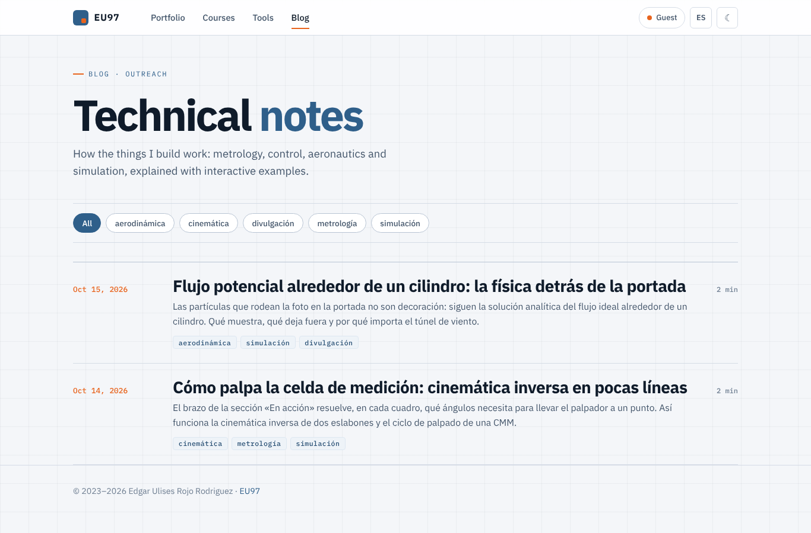 | 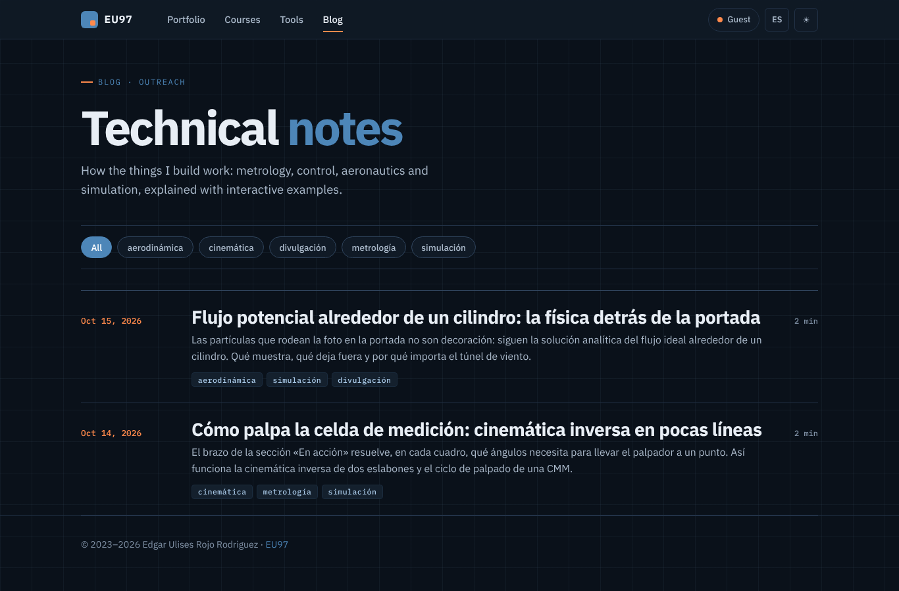 |

Móvil:

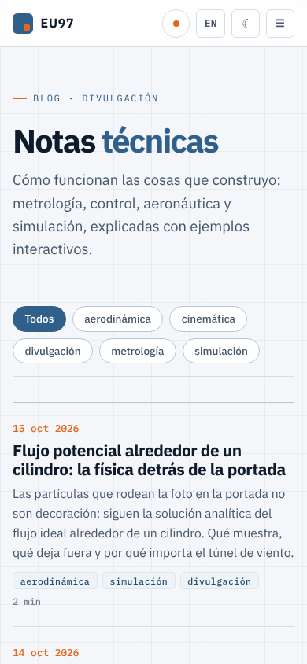 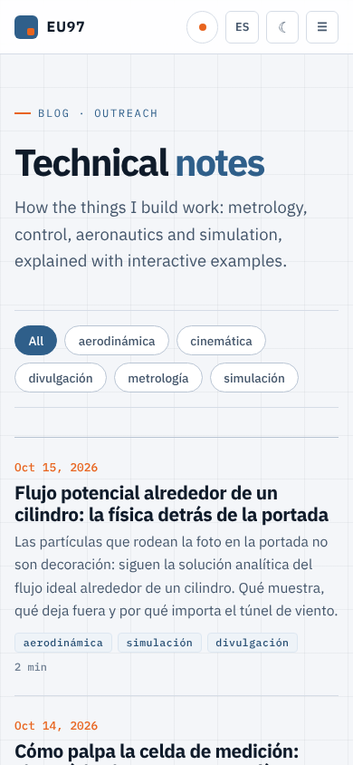 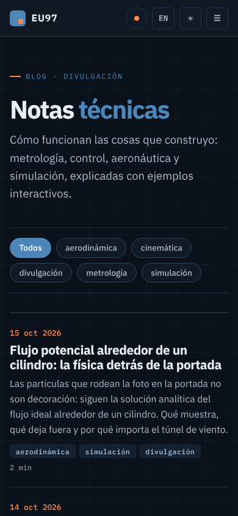 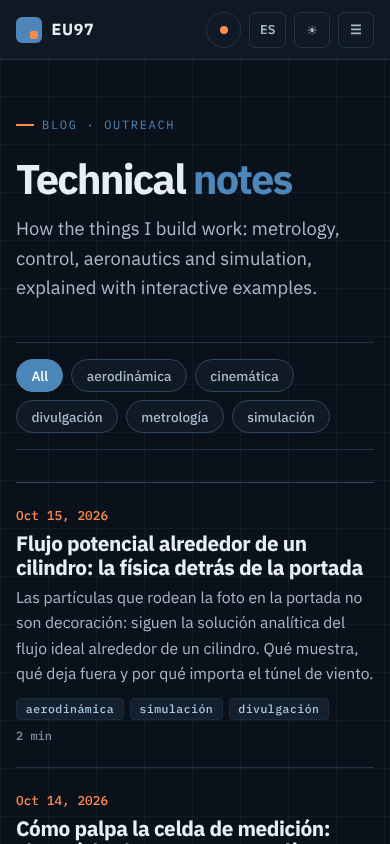 

## /blog/posts/flujo-potencial-cilindro.html

| Escritorio claro | Escritorio oscuro |
|---|---|
|  | 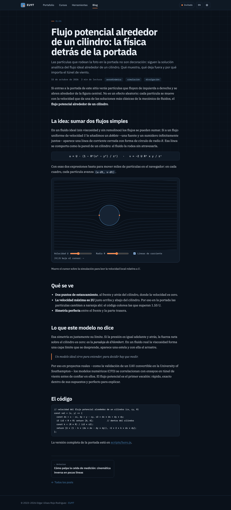 |
| 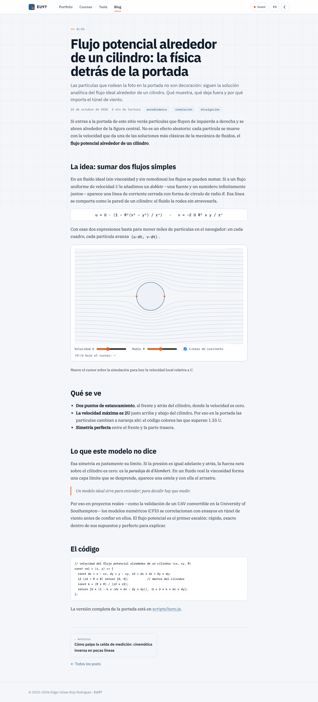 | 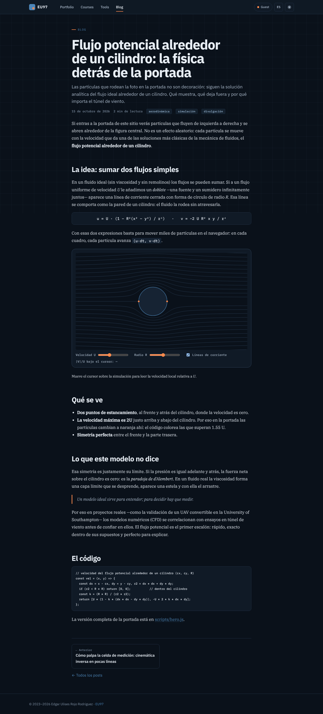 |

Móvil:

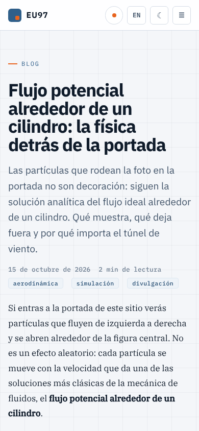  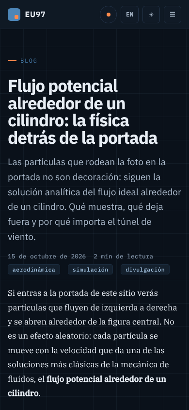  

## /blog/posts/celda-de-medicion-cinematica.html

| Escritorio claro | Escritorio oscuro |
|---|---|
| 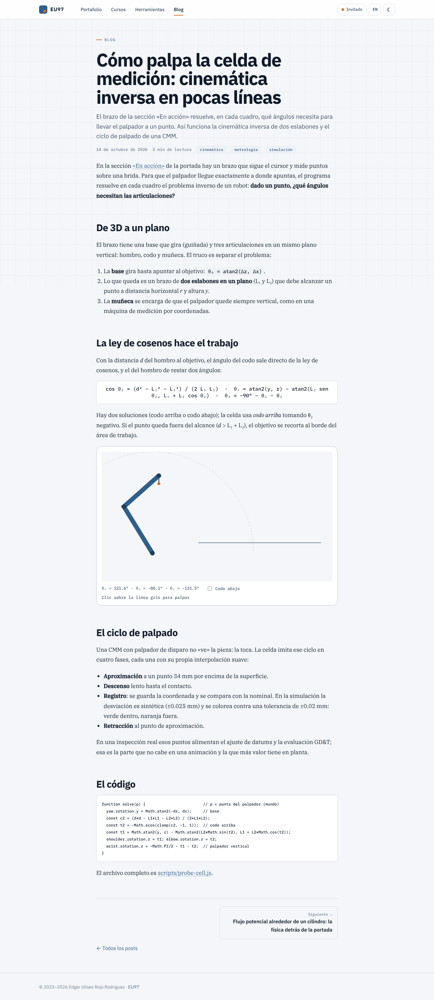 |  |
| 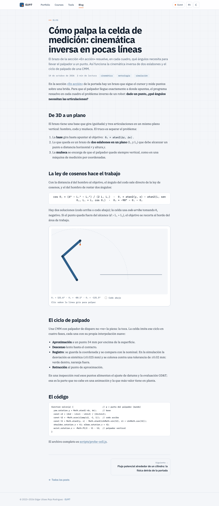 | 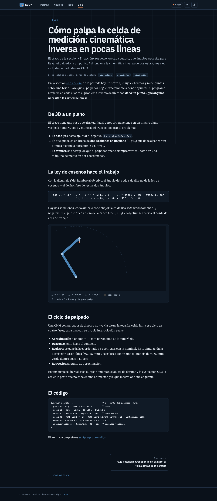 |

Móvil:

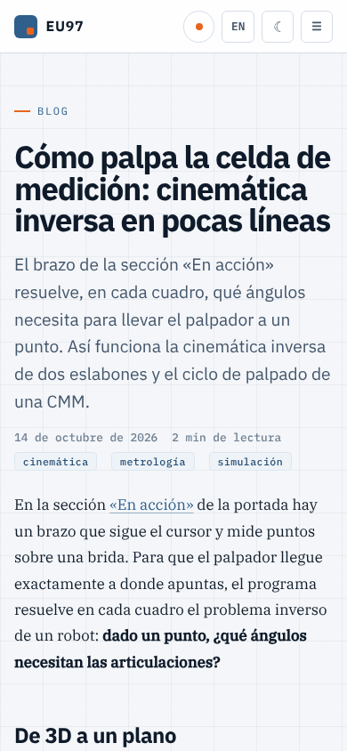  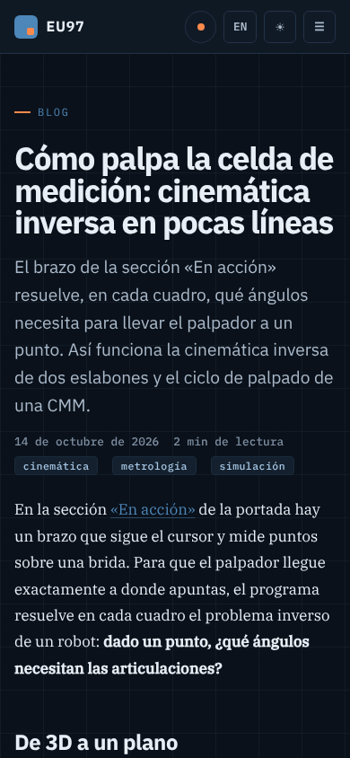 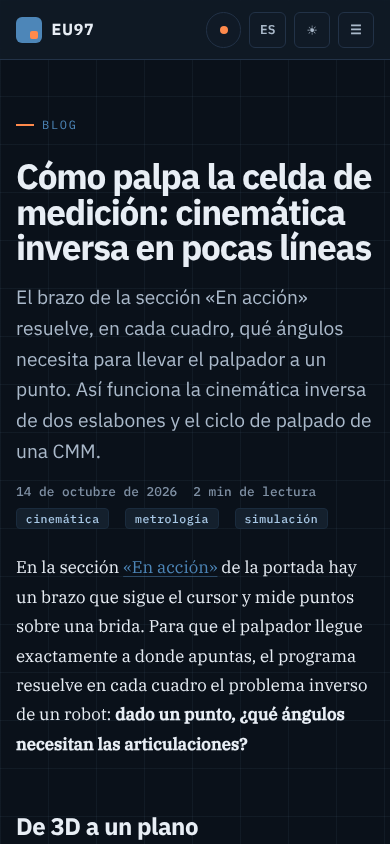 

## Interacción

Índice con filtro por etiqueta, post en oscuro y claro con la demo de flujo potencial, y la demo de cinemática inversa.

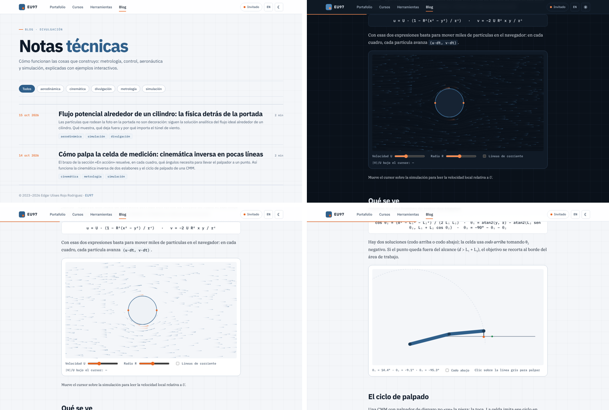
