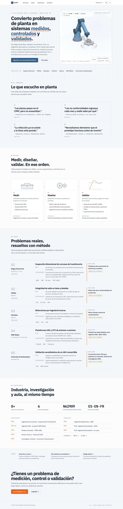
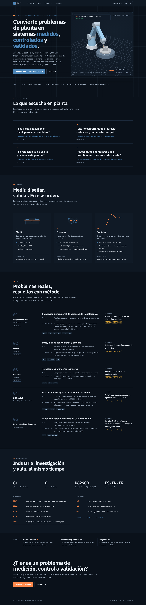
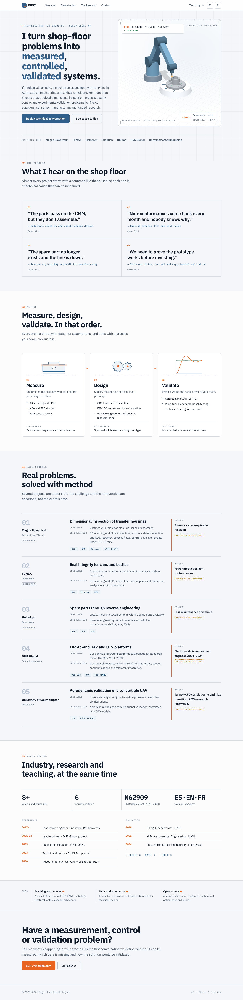
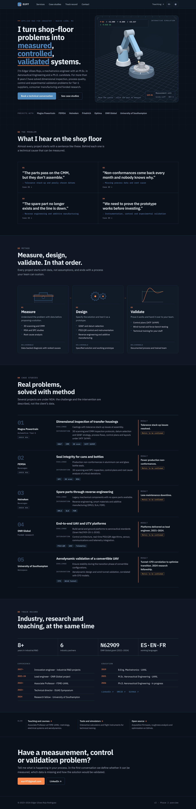
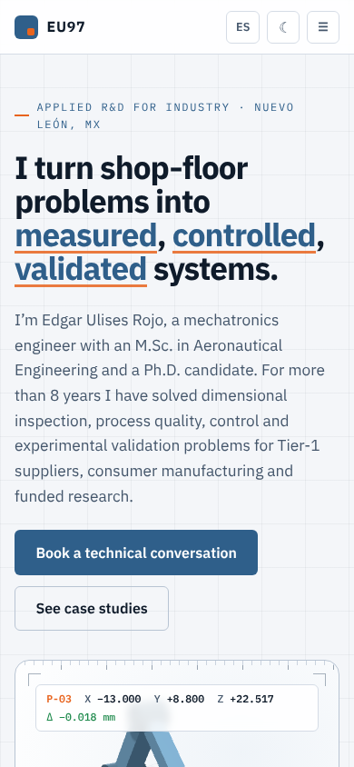
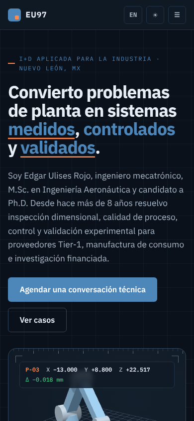
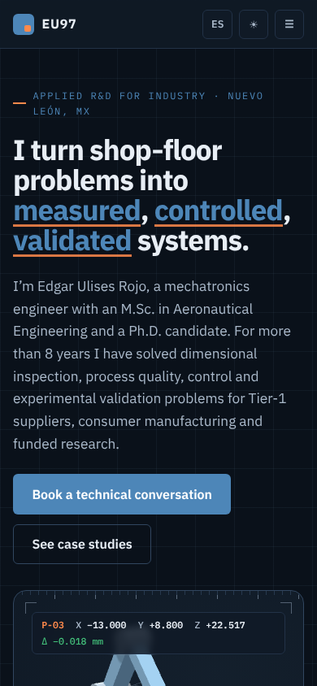
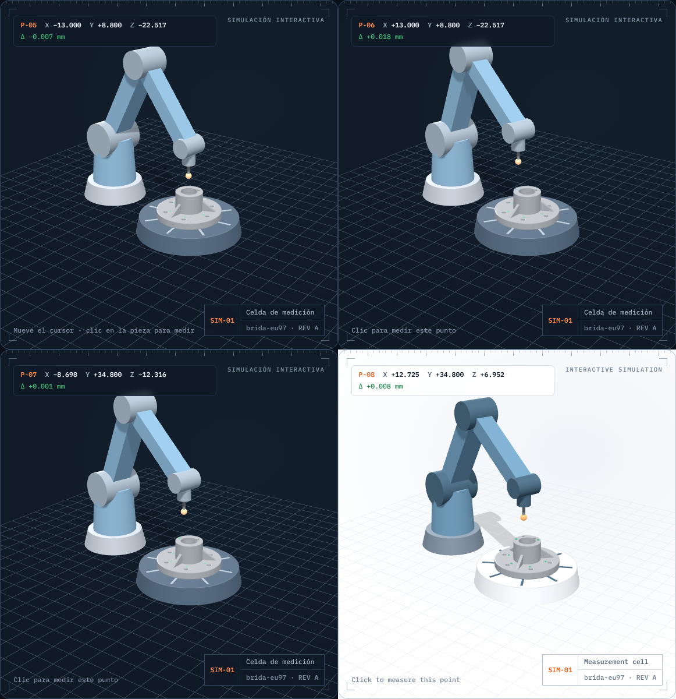
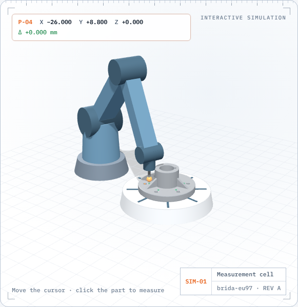

# Vista previa — fase2

Generado con `node tools/screenshot.mjs fase2 /v2/`.

## /v2/

| Escritorio claro | Escritorio oscuro |
|---|---|
|  |  |
|  |  |

Móvil:

    

## Interacción (sin movimiento reducido)

Las capturas de arriba usan `prefers-reduced-motion: reduce` (pose fija). Estas muestran la celda animada: ciclo automático, cursor sobre la pieza, punto medido con clic y cambio en vivo a claro/EN.

Instante de contacto del palpador:

