# Vista previa — fase4

Generado con `node tools/screenshot.mjs fase4 / /404.html`.

## /

| Escritorio claro | Escritorio oscuro |
|---|---|
| 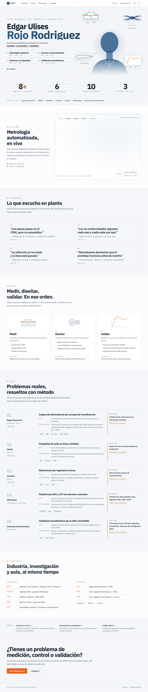 | 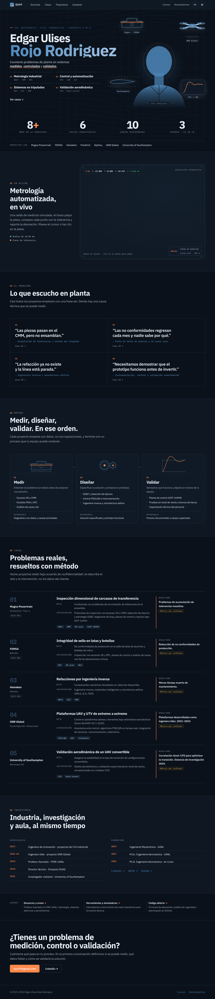 |
| 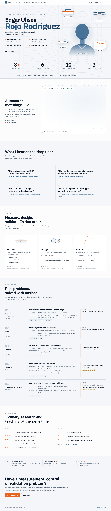 | 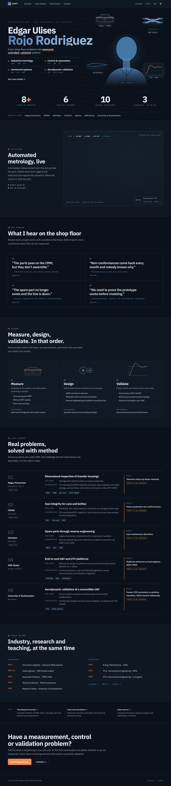 |

Móvil:

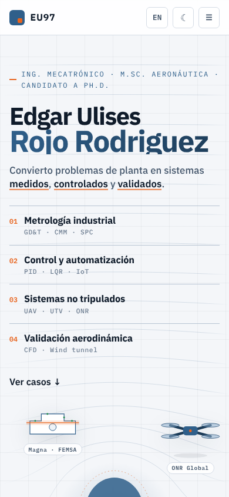 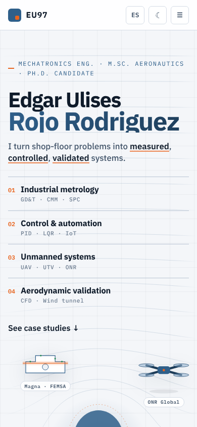 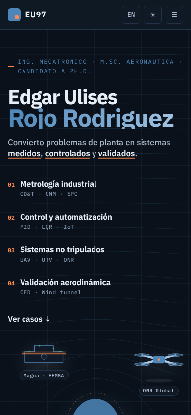 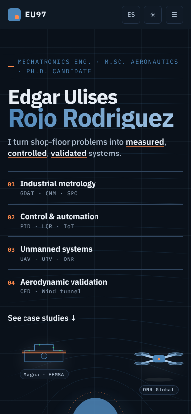 

## /404.html

| Escritorio claro | Escritorio oscuro |
|---|---|
| 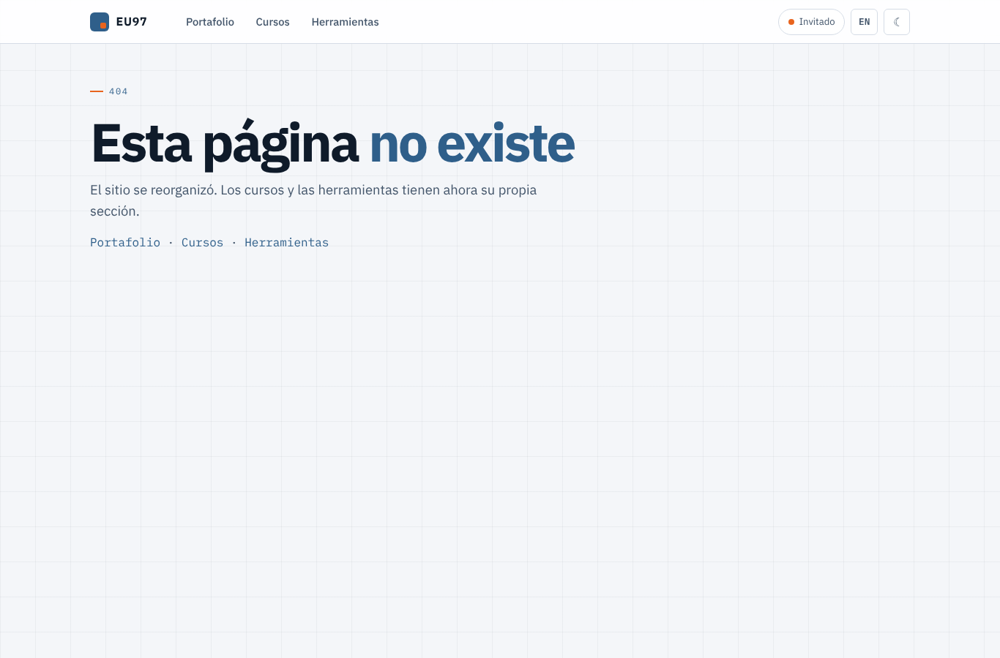 | 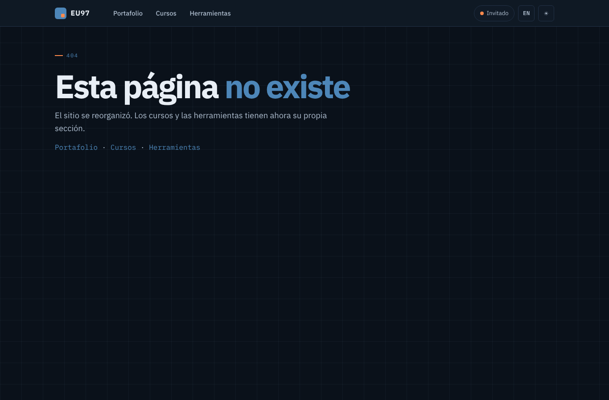 |
| 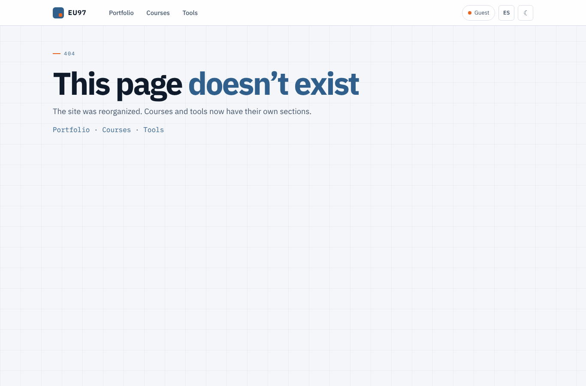 | 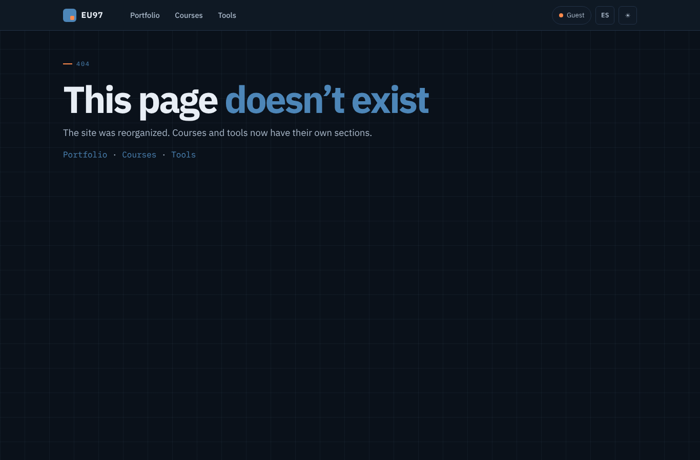 |

Móvil:

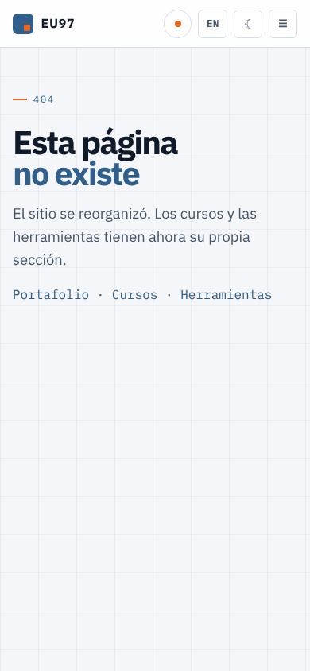 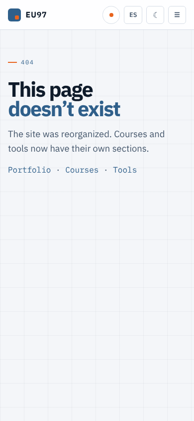 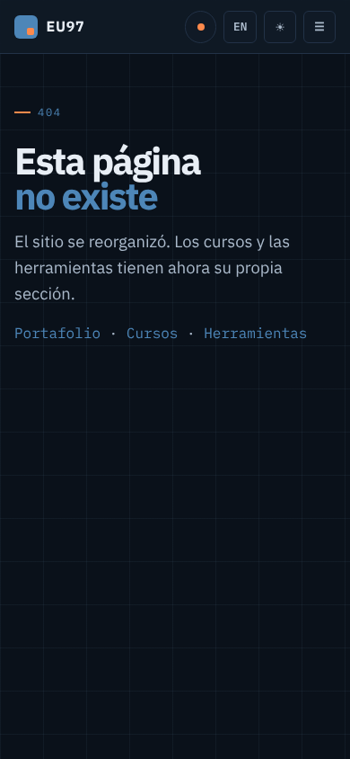 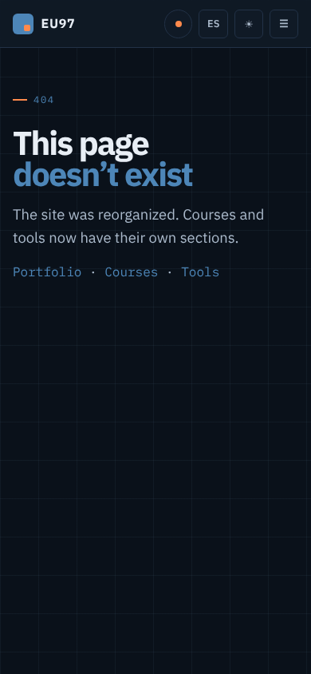 

## Redirecciones verificadas

Generadas con `node tools/redirects.mjs` desde `docs/redirects.json` (conservan `?query` y `#hash`). Probadas en Chromium:

| Ruta antigua | Ruta nueva |
|---|---|
| `/curso/DSM/` | `/cursos/dsm/` |
| `/curso/Dibujo Computarizado/T01-etapas-diseno.html` | `/cursos/dibujo-computarizado/T01-etapas-diseno.html` |
| `/addons/S01-fundamentos-cad.html` | `/cursos/dibujo-computarizado/S01-fundamentos-cad.html` |
| `/curso/Taller Mecatronica/taller-mecatronica.html` | `/cursos/taller-mecatronica/` |
| `/projects/flight-instruments.html?x=1#y` | `/herramientas/instrumentos-vuelo/?x=1#y` |
| `/projects/pso-optimal.html` | `/proyectos/pso-optimal.html` |
| `/CMindex.html` | `/proyectos/ciencia-magica.html` |
| `/v2/` | `/` |
| `/#precision` | `/cursos/` |
| `/#projects`, `/#contact` | `/#casos`, `/#contacto` |

## Barra común en simuladores

Píldora flotante en Shadow DOM (`scripts/sim-bar.js`): no altera los estilos del simulador.

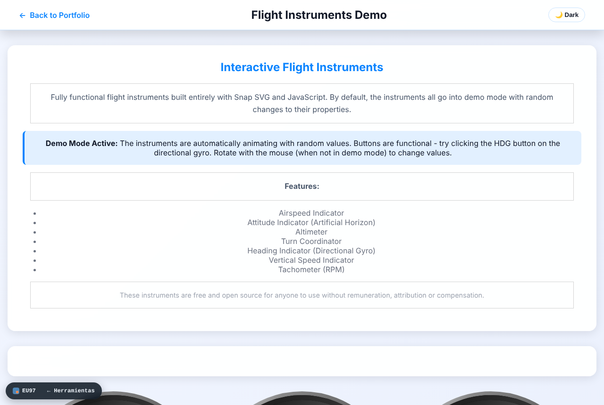
