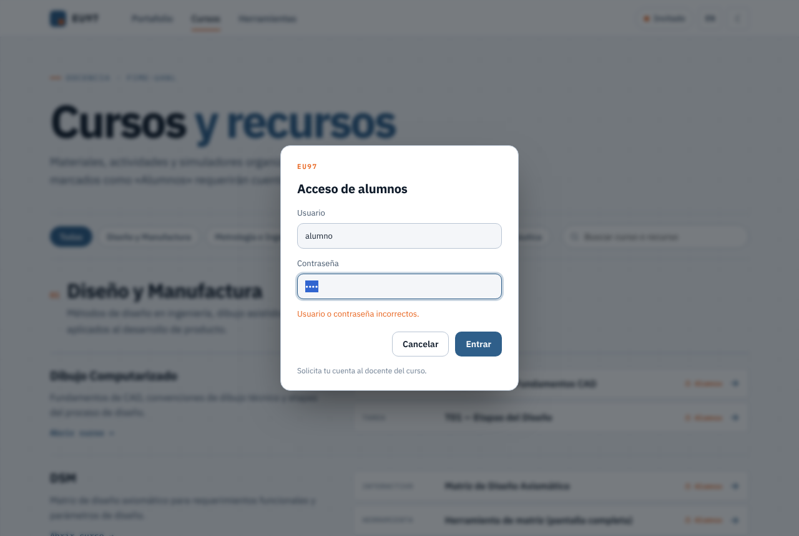
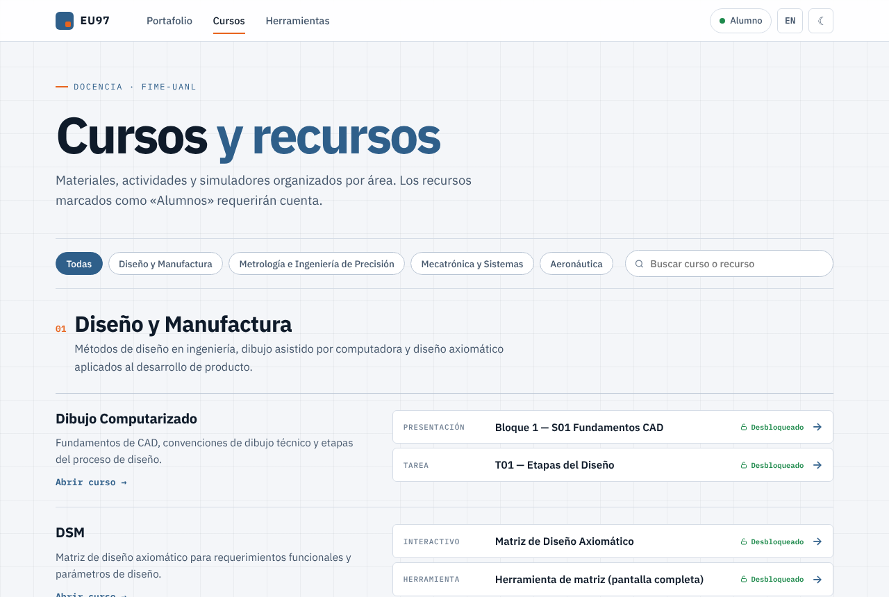

# Vista previa — fase5 (login con usuarios fijos)

Probado en Chromium (ver `docs/AUTH.md`): contraseña incorrecta, inicio de sesión desde la píldora de la barra,
recursos desbloqueados en el hub, cuenta con acceso parcial y cierre de sesión. Sin errores de consola.

Diálogo con contraseña incorrecta:

Sesión iniciada: la píldora muestra el nombre y los recursos aparecen como «Desbloqueado»:

