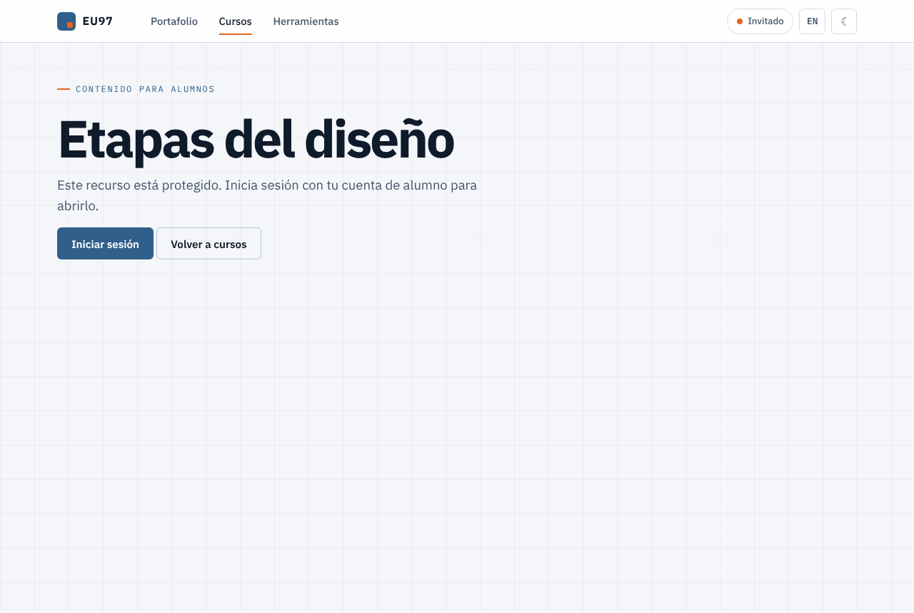
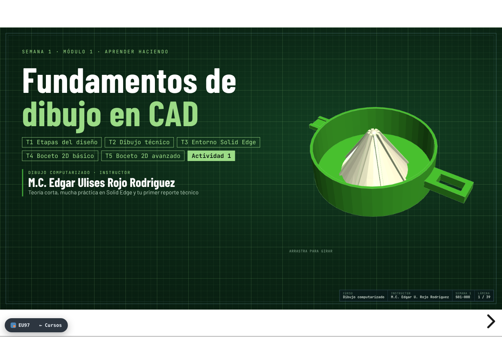
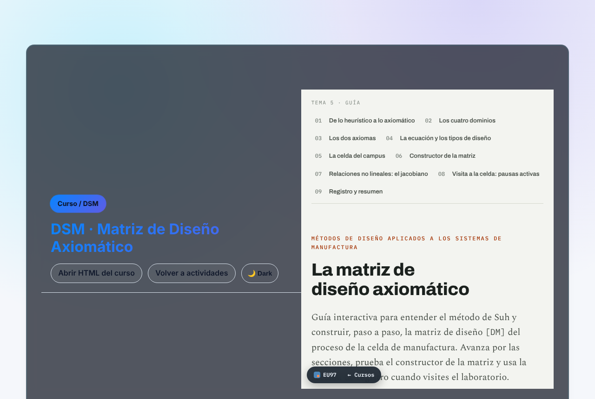

# Vista previa — fase6 (cifrado migrable)

6 páginas cifradas con AES-GCM (3 llaves de curso). Probado en Chromium: todas se descifran tras iniciar sesión,
incluidos los iframes cifrados dentro de páginas cifradas (DSM y Actividad 4); una cuenta sin acceso al curso ve
«Tu cuenta no tiene acceso a este curso».

Cascarón sin sesión:

S01 descifrada (reveal.js + visor 3D funcionando):

DSM descifrada con su iframe cifrado también abierto:

