# Vista previa — fase7

Generado con `node tools/screenshot.mjs fase7 /herramientas/visor-3d/ /herramientas/`.

## /herramientas/visor-3d/

| Escritorio claro | Escritorio oscuro |
|---|---|
| 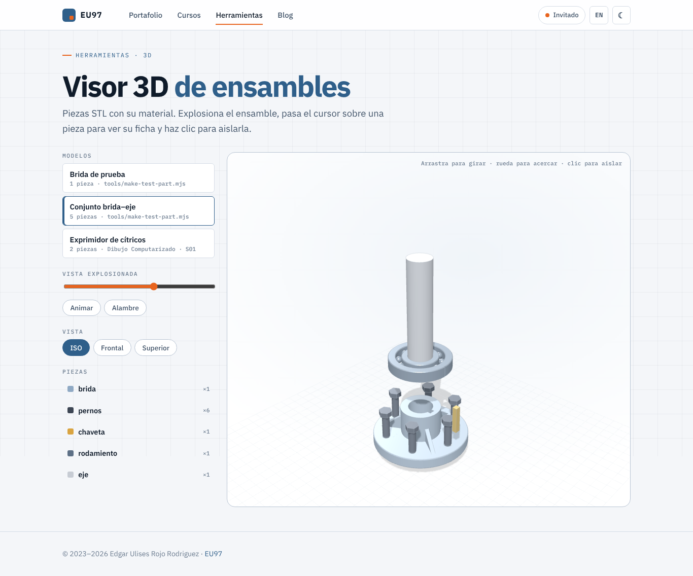 | 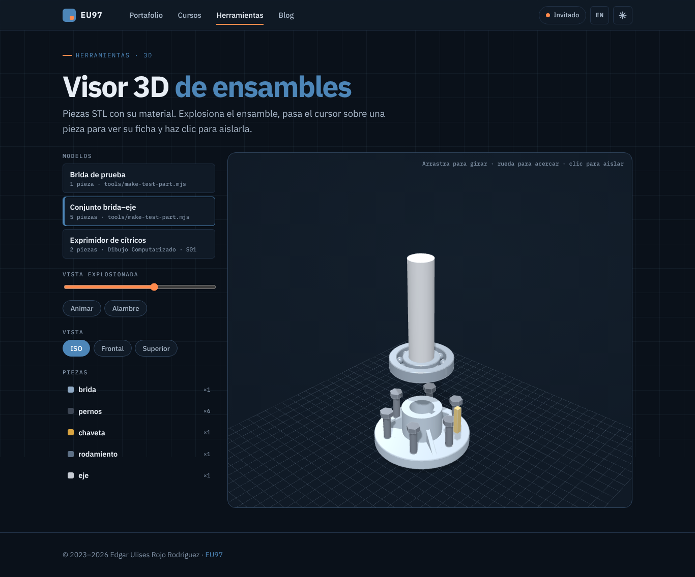 |
| 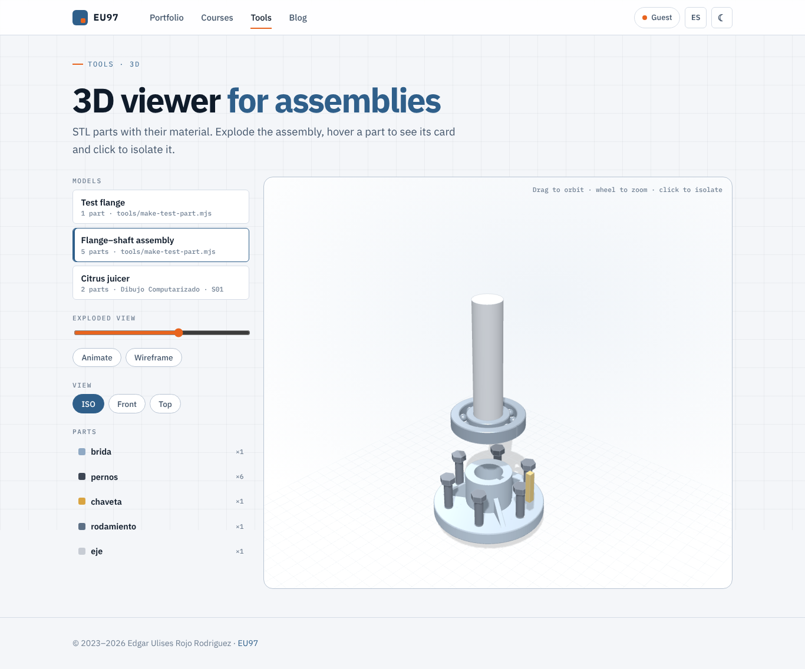 | 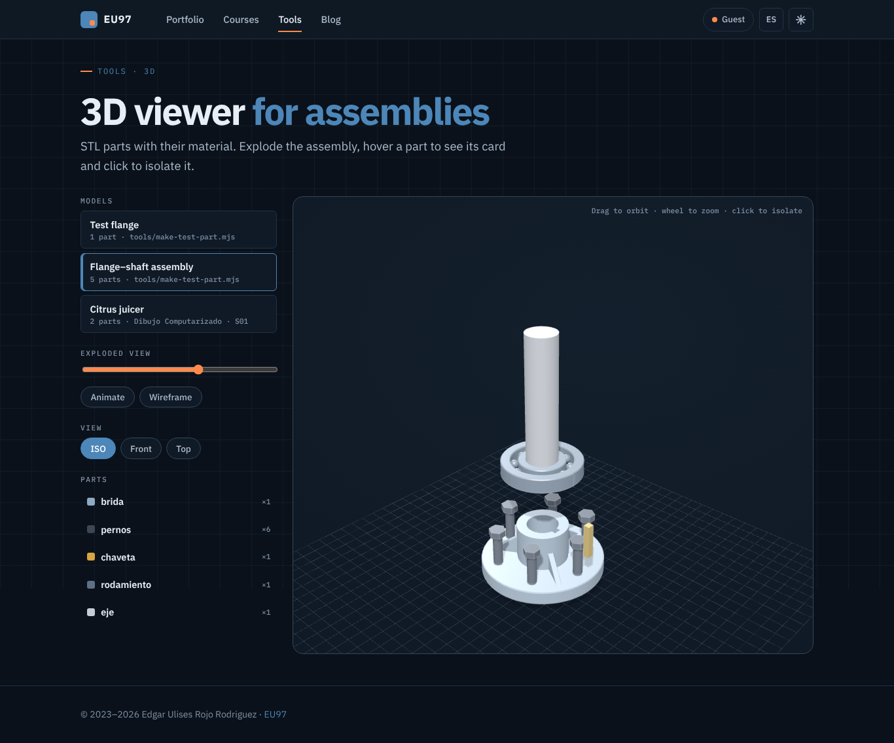 |

Móvil:

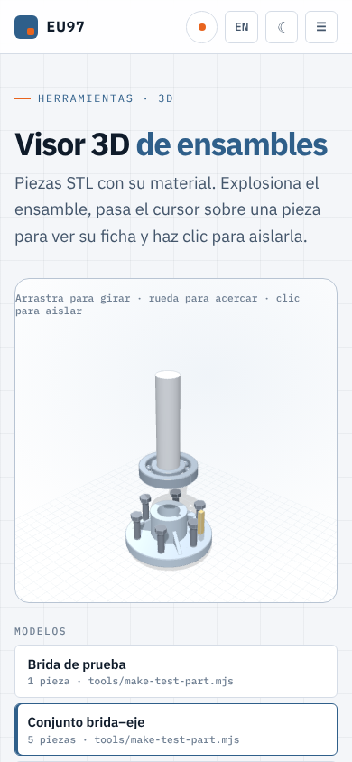 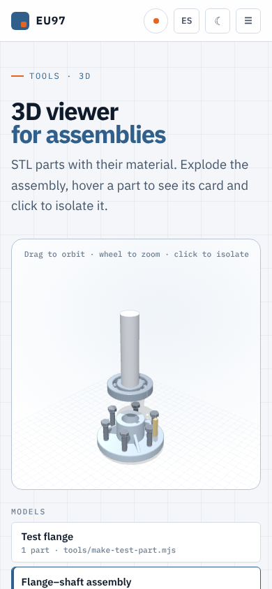 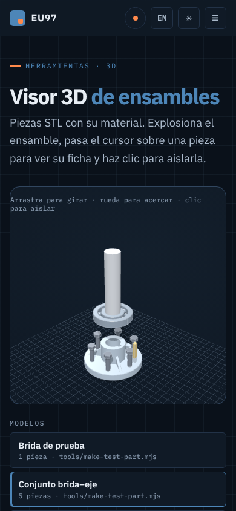 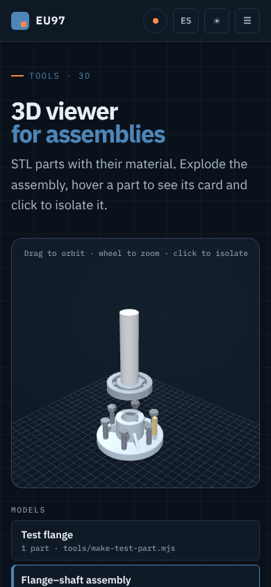 

## /herramientas/

| Escritorio claro | Escritorio oscuro |
|---|---|
| 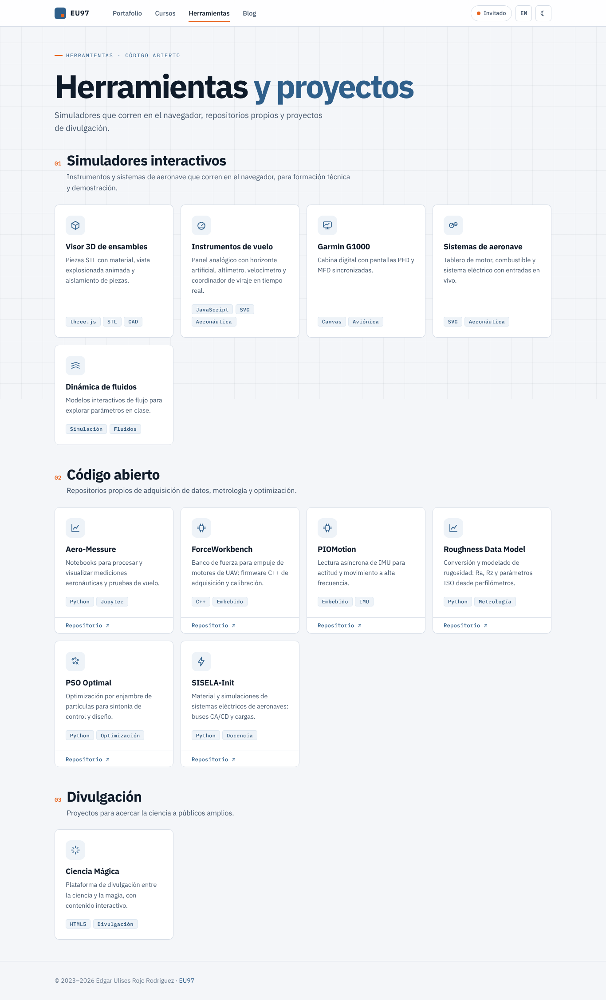 | 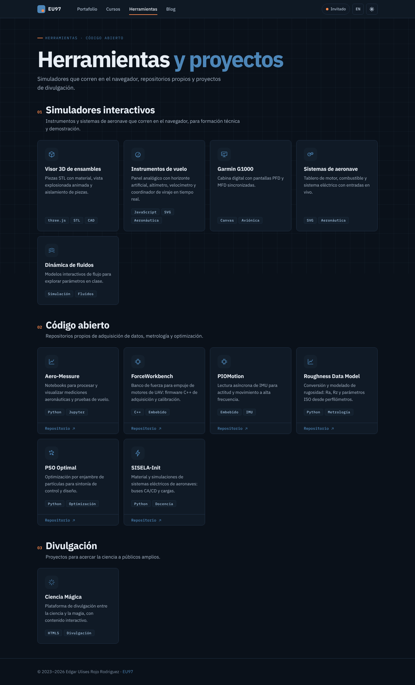 |
| 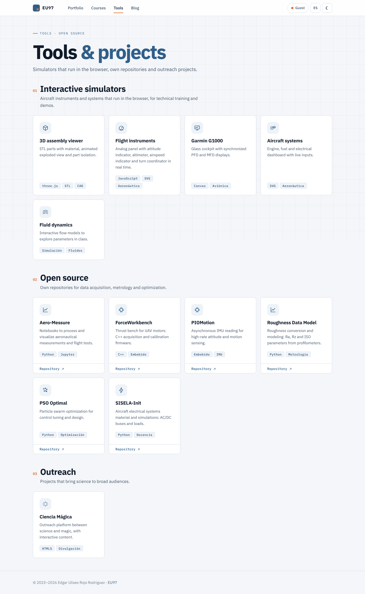 | 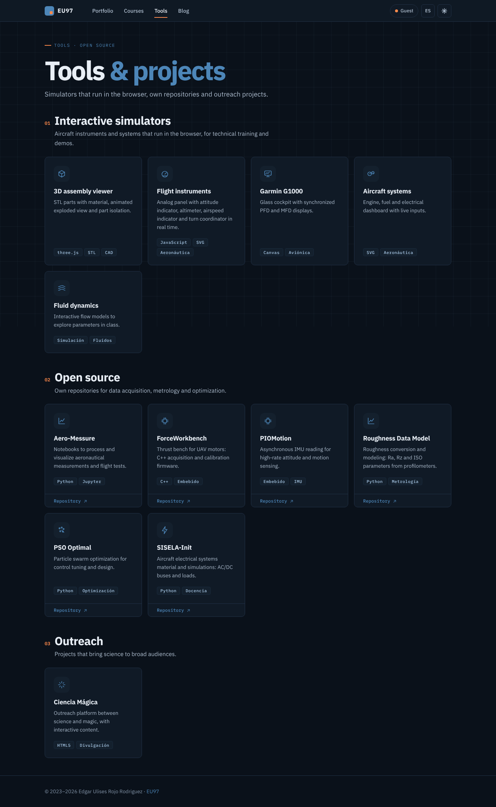 |

Móvil:

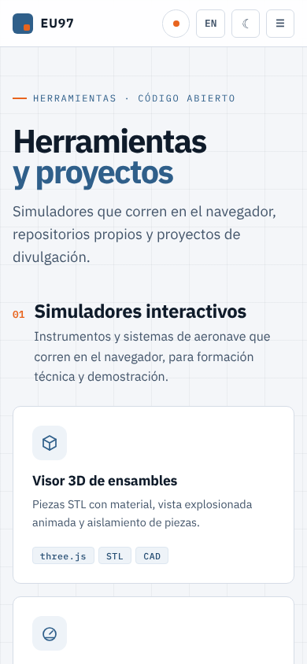 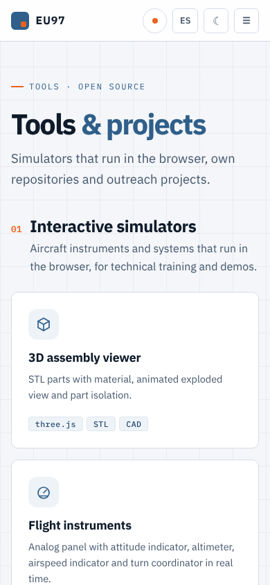 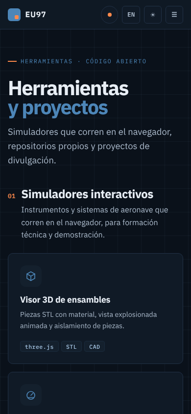 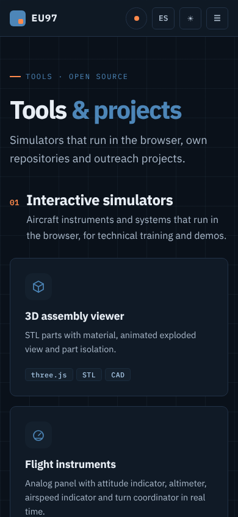 

## Interacción (sin movimiento reducido)

Conjunto brida–eje ensamblado, explosionado, con el eje aislado (clic) y el exprimidor extraído de S01.

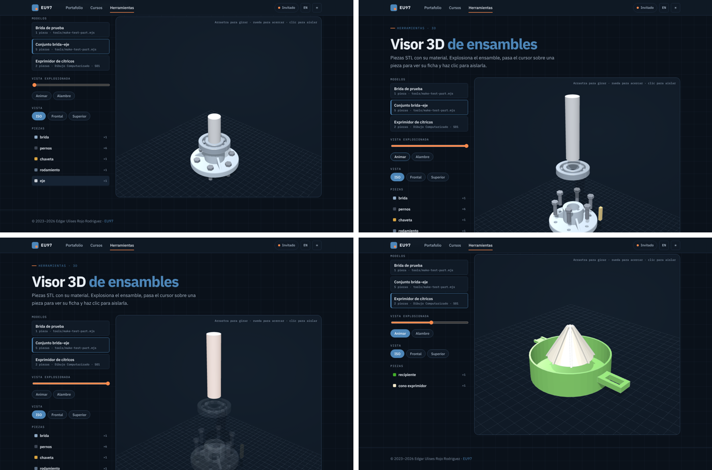
